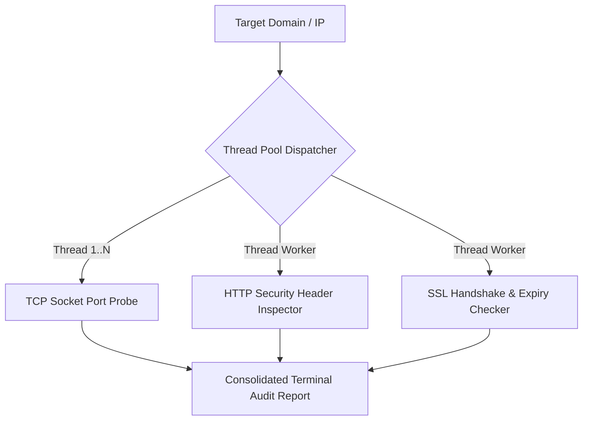

# 🛡️ PySec Recon Scanner (Automated Security Hygiene Tool)

[](https://www.python.org/)
[](#)
[](#)
[](https://opensource.org/licenses/MIT)

A lightweight, multi-threaded Python reconnaissance and basic vulnerability scanning tool designed to assess domain security hygiene, open network services, HTTP response security headers, and SSL/TLS certificate health.

---

## 🚀 Capabilities
- **Multi-Threaded Port Scanner:** Rapidly checks critical infrastructure ports (SSH, FTP, HTTP, HTTPS, DB ports) using non-blocking socket connections with timeout limits.
- **HTTP Security Header Audit:** Audits OWASP-recommended security headers such as `Strict-Transport-Security (HSTS)`, `Content-Security-Policy (CSP)`, `X-Frame-Options`, and `Permissions-Policy`.
- **SSL/TLS Certificate Life-Cycle Check:** Inspects the target's public certificate and calculates the remaining valid days before expiration.

---

## 🧠 Scanning Architecture



---

## 🛠️ Quick Start

1. **Clone the repository:**
   ```bash
   git clone https://github.com/your-username/PySec-Recon-Scanner.git
   cd PySec-Recon-Scanner
   ```

2. **Install dependencies:**
   ```bash
   pip install -r requirements.txt
   ```

3. **Run the scanner:**
   ```bash
   python scanner.py
   ```

---

## 📋 Sample Terminal Output
```text
=================================================================
🛡️  PySec-Recon: Otomatik Zafiyet ve Keşif Aracı
=================================================================
[*] 1. Port Taraması Başlatılıyor (193.140.x.x)...
    [+] Port 80    [HTTP              ]: AÇIK (OPEN)
    [+] Port 443   [HTTPS             ]: AÇIK (OPEN)

[*] 2. HTTP Güvenlik Başlıkları (Security Headers) Analizi...
    [OK]  Strict-Transport-Security : Mevcut
    [OK]  X-Frame-Options           : Mevcut
    [EKSİK] Content-Security-Policy   : Bulunamadı (Tavsiye Edilir)

[*] 3. SSL/TLS Sertifika Kontrolü...
    [+] Sertifika Bitiş Tarihi: Dec 15 23:59:59 2026 GMT
    [+] Kalan Gün Sayısı      : 74 gün
```
